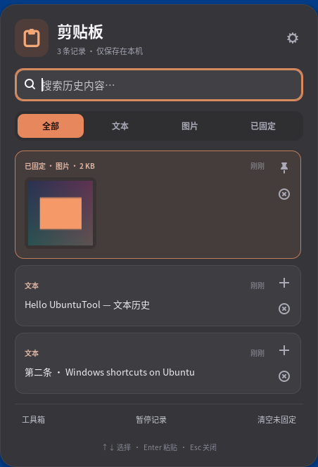
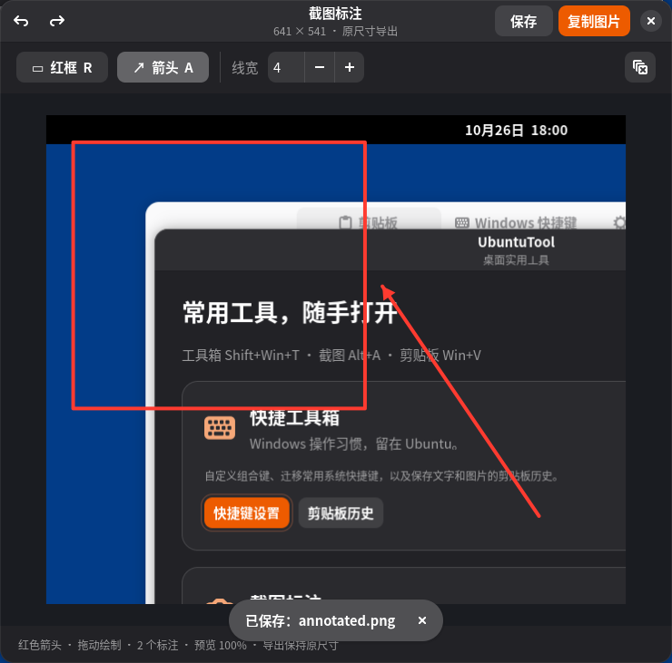
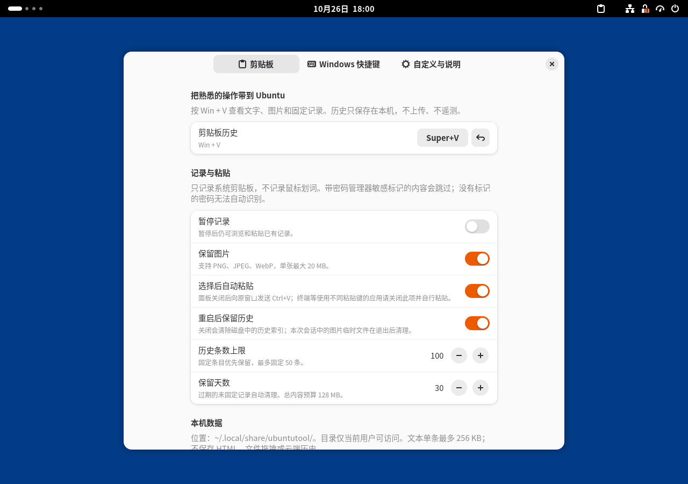

# UbuntuTool

Ubuntu 桌面工具集合。现在包含 **快捷工具箱** 和 **截图标注** 两个工具：Windows 快捷键迁移、支持文字 / 图片的 Win+V 历史，以及 Alt+A 矩形截图与红框 / 箭头标注。采用原生 GNOME Shell + GTK4 / Libadwaita，无 Electron、无服务器、无云同步或遥测。

## 工具入口与截图

- **Win + Shift + T**：打开 UbuntuTool 工具箱。现有的快捷键迁移和剪贴板功能归入「快捷工具箱」。
- **Alt + A**：拖动框选矩形截图区域，松开后进入标注窗口；按 Esc 取消截图。
- 标注窗口提供**红色矩形框、红色箭头、线宽、撤销 / 重做**，支持复制图片和另存为 PNG。
- 预览会自动适应窗口，导出保持截图原始像素尺寸；不会把工具栏或预览缩放写进图片。
- 标注窗口中：R 红框、A 箭头、Ctrl+Z 撤销、Ctrl+Shift+Z 重做、Ctrl+C 复制、Ctrl+S 保存。
- 复制后的标注图片由 Shell 扩展保管，关闭标注窗口后仍可粘贴，并进入 Win+V 历史（未暂停记录且图片记录开启时）。
- 可从工具箱打开已有的本机 PNG 进行标注。关闭尚未复制 / 保存的标注时会提示保留，原始文件不被覆盖。
- 工具箱和截图热键可在「快捷工具箱 → Windows 快捷键 → 应用与桌面入口」重新录制或修改，独立于 Windows 快捷键方案生效。

截图原图临时保存在 `~/.cache/ubuntutool/captures/`，目录权限 0700、文件权限 0600。正常关闭截图标注窗口时删除原图；异常退出遗留超过 7 天的临时文件在扩展下次启用时清理。保存后的用户图片不会自动删除。

## 界面截图

以下均为 GNOME 50 中实际运行的界面，使用合成测试内容，不包含用户剪贴板数据。点击图片可查看原图。

| UbuntuTool 工具入口 | Win+V 剪贴板历史 |
| --- | --- |
| [](docs/toolbox.png) | [](docs/clipboard.png) |

| 红框与箭头截图标注 | 快捷工具箱设置 |
| --- | --- |
| [](docs/screenshot-editor.png) | [](docs/preferences.png) |

## 当前功能

- **Win + V**：搜索、浏览、恢复文字和 PNG / JPEG / WebP 图片；支持固定、删除、暂停记录和清空。
- 选择记录后关闭面板，并向原窗口发送 Ctrl+V；可关闭自动粘贴，改为选择后自己粘贴。终端通常使用 Ctrl+Shift+V，应关闭自动粘贴。
- 默认保存 100 条、未固定记录保留 30 天；可调整到 10–500 条、1–365 天。最多固定 50 条。
- 图片单条上限 20 MB，文本单条上限 256 KB，总内容预算 128 MB。重复复制同一条只更新排序，不重复占空间。
- Windows 快捷键方案可一键关闭，单条可录制、编辑、禁用和还原；可添加自己的组合键和命令。
- 暂时借用 GNOME 冲突组合键（例如原生 Win+V 通知面板）。禁用扩展或卸载时恢复原设置；保留用户在启用期间做过的新修改。

## 适配范围

面向 **Ubuntu GNOME / GNOME Shell 46–50**，优先验证 Ubuntu 26.04 的 GNOME 50。Ubuntu 24.04 / GNOME 46 列为兼容目标，但需要分别实机回归；不支持 Ubuntu 22.04 的 GNOME 42、KDE 或 XFCE。

本工具迁移系统级 Windows 操作习惯，不宣称复制所有 Windows 系统服务或重写每个应用的快捷键。安全桌面、游戏栏等没有通用 Ubuntu 对应物；应用内部的 Ctrl+C、Ctrl+S 等仍由应用自己处理。设置中的适配说明列出原生支持项和差异。

| Windows 组合键 | UbuntuTool 的操作 |
| --- | --- |
| Win + Shift + T（工具默认值） | UbuntuTool 工具箱 |
| Alt + A（工具默认值） | 矩形框选截图 → 红框 / 箭头标注 |
| Win + V | 文字 / 图片剪贴板历史 |
| Win + E / R / I / S | 文件管理器 / 运行 / 系统设置 / 搜索 |
| Win + A / Win + . | 快速设置 / 字符与表情应用 |
| Ctrl + Shift + Esc | GNOME 系统监视器 |
| Win + D / ↑ / ↓ / ← / → | 桌面 / 最大化 / 还原 / 左右平铺 |
| Win + M / Win + Shift + M | 最小化当前工作区全部窗口 / 恢复上次最小化的窗口 |
| Alt + Tab / Alt + Shift + Tab | 正向 / 反向切换窗口 |
| Win + Tab | GNOME 任务概览 |
| Win + Shift + S / Print | GNOME 截图面板 |
| Ctrl + Win + ← / → | 左右切换工作区 |
| Win + Shift + ← / → | 移到另一侧显示器 |
| Alt + F4 / Alt + 空格 | 关闭窗口 / 窗口菜单 |

## 安装

在 **Ubuntu 实际登录的普通桌面用户**下运行，不要在 root 的受限 Codex 沙箱里执行桌面设置。

```bash
git clone https://github.com/zhaoshi2000/UbuntuTool.git
cd UbuntuTool
bash scripts/install.sh
```

必要工具一般随 Ubuntu GNOME 提供：`gnome-shell`、`gnome-extensions`、`gjs`、`libglib2.0-bin`、`python3-gi`。需要系统监视器或表情应用时安装：

```bash
sudo apt install gnome-system-monitor gnome-characters
```

首次安装后，如果当前会话尚未发现新扩展，**注销并重新登录**，再按 Win+Shift+T、Alt+A 或 Win+V。安装器会给出实际状态；不会强制注销、重启 GNOME 或开启 Shell 调试接口。

如果通过 root 终端安装，显式指定桌面用户，安装器会切换身份，并连接该用户的桌面会话：

```bash
bash scripts/install.sh --user xh
```

只复制扩展、暂不启用：`bash scripts/install.sh --no-enable`。

也可将打包产生的 `.shell-extension.zip` 下载到 Ubuntu 后运行：

```bash
gnome-extensions install --force ubuntutool@zhaoshi2000.shell-extension.zip
# 若是首次安装，注销并重新登录后：
gnome-extensions enable ubuntutool@zhaoshi2000
gnome-extensions prefs ubuntutool@zhaoshi2000
```

## 设置和卸载

应用菜单中打开 **UbuntuTool** 进入工具集合，或运行：

```bash
~/.local/bin/ubuntutool           # 工具箱
~/.local/bin/ubuntutool screenshot # 截图
~/.local/bin/ubuntutool prefs
~/.local/bin/ubuntutool status
~/.local/bin/ubuntutool disable
~/.local/bin/ubuntutool restore   # Shell 曾异常退出时，恢复借用的系统快捷键
bash scripts/uninstall.sh
```

更新前安装器会备份旧扩展，并先恢复旧快捷键。不主动删除剪贴板历史；需要时先在设置中删除全部历史。禁用扩展或锁屏后不再监控剪贴板。

GNOME 会缓存已加载的扩展模块，**从旧版升级后也请注销并重新登录**，确保新增的工具箱和截图热键加载到当前会话。

## 隐私与存储

- 数据目录：`~/.local/share/ubuntutool/`，权限 `0700`；索引、图片文件权限 `0600`。
- 历史含敏感信息，当前实现不加密，不提供跨设备同步。设置中可以暂停记录、关闭持久化或清空记录。
- 遇到密码管理器的敏感 MIME 标记会跳过；没有标记的敏感文本无法可靠识别。不会为记录内容打印日志。
- 只监控标准剪贴板，不监控鼠标主选择区；不恢复文件拖拽、HTML 富文本或表情贴图商店等 Windows 专有功能。
- 数据格式校验、原子替换索引、图片文件名白名单、过期清理和磁盘预算限制均在本机执行。

## 开发与验证

无需 npm 依赖，Node 20+ 可运行模型和快捷键恢复测试：

```bash
npm test
npm run check
python3 tools/package.py
```

在 Ubuntu GNOME 上运行隔离的 Wayland 集成测试：

```bash
python3 tests/shell-session.py --artifacts work/integration
python3 tests/install-smoke.py
```

测试创建临时 HOME、私有 D-Bus 和无头 GNOME 会话，使用合成文本 / 图片验证捕获、去重、面板、图片恢复、暂停、持久化、权限和快捷键还原。测试专用扩展只在临时会话内开启调试，不会安装到用户桌面，也不进入发布扩展包。截图和日志位于指定 artifacts 目录。

2026-10-26 的验证环境为 Ubuntu 26.04.1 / GNOME Shell 50.1 / GJS 1.88.0。除剪贴板和安装测试外，截图版本新增几何 / 缩放 / 撤销测试，以及实际热键、矩形拖选、标注绘制、PNG 导出和复制到历史的隔离会话验证。GNOME 46–49、X11 和其他显卡环境尚未分别实机回归。

源码：`extension/`；安装脚本：`scripts/`；测试：`tests/`。构建产物：`dist/`。

## 许可证

MIT。
